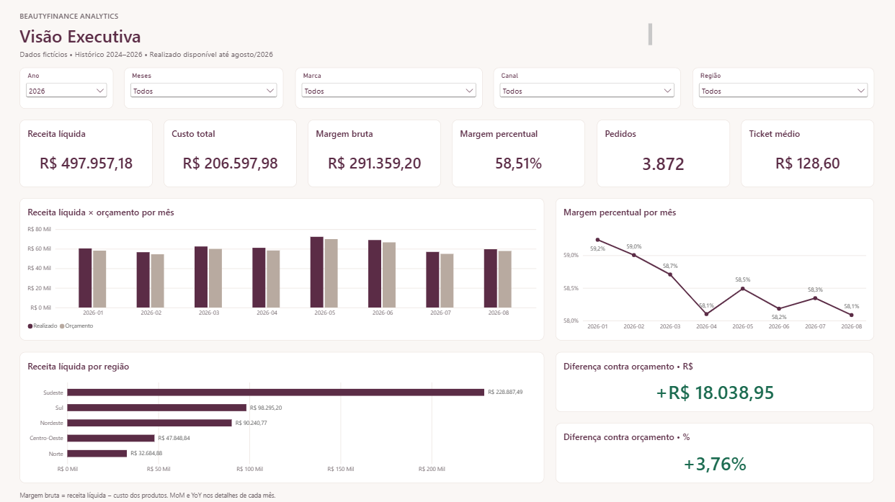
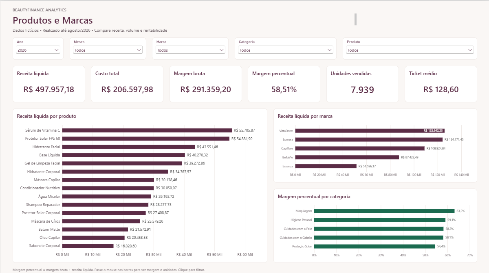
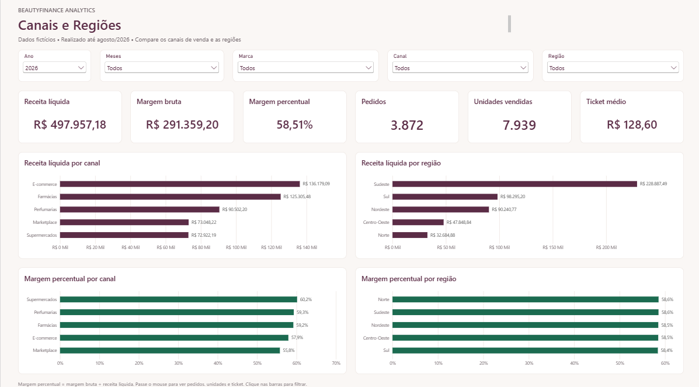
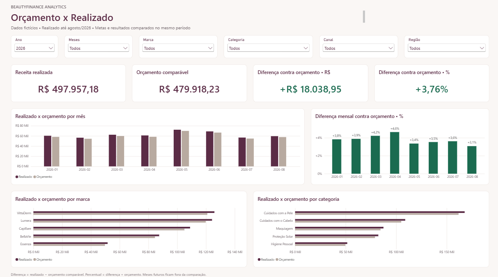
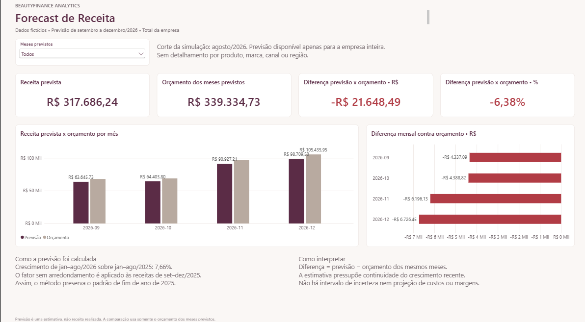

# BeautyFinance Analytics

Análise financeira e comercial de uma empresa fictícia de cosméticos, com dados tratados em Python, consultas em PostgreSQL/Supabase e dashboard em Power BI.

O projeto acompanha receita, custos, margem e desempenho por produto, marca, canal e região. Compara o realizado ao orçamento do mesmo período e estima a receita dos quatro meses finais de 2026.

> Todos os dados, marcas, produtos e resultados são fictícios, criados para estudo e portfólio.

## Resultados de janeiro a agosto de 2026

| Indicador | Resultado |
|---|---:|
| Receita líquida | R$ 497.957,18 |
| Custo total | R$ 206.597,98 |
| Margem bruta | R$ 291.359,20 |
| Margem percentual | 58,51% |
| Pedidos distintos | 3.872 |
| Ticket médio | R$ 128,60 |
| Orçamento comparável | R$ 479.918,23 |
| Diferença contra orçamento | +R$ 18.038,95 (+3,76%) |

A receita ficou acima da meta no período, mas o recorte de Supermercados ficou R$ 3.679,82 abaixo do orçamento (-4,80%). Isso permite investigar diferenças entre canais além do resultado consolidado.

O histórico disponível vai de janeiro de 2024 a agosto de 2026. O orçamento cobre janeiro de 2024 a dezembro de 2026. Comparações de realizado usam somente o orçamento até o fim do último mês com vendas, mantendo os filtros selecionados.

## Dashboard

| Página | Análises |
|---|---|
| Visão Executiva | Indicadores financeiros, receita mensal e comparações de desempenho |
| Produtos e Marcas | Receita, margem, unidades e rankings por produto e marca |
| Canais e Regiões | Receita e margem por canal e região |
| Orçamento x Realizado | Metas, diferenças em reais e percentuais por mês, marca e categoria |
| Forecast | Previsão mensal de receita e comparação com o orçamento futuro |

### Visão Executiva



### Produtos e Marcas



### Canais e Regiões



### Orçamento x Realizado



### Forecast



*Capturas atuais do Desktop, após a melhoria de legibilidade dos gráficos. As páginas de realizado mostram 2026, com os demais filtros em Todos; o Forecast mostra os quatro meses previstos.*

## Forecast: método e limites

A previsão usa a razão entre as receitas de janeiro a agosto de 2026 e do mesmo período de 2025. Esse fator, sem arredondamento intermediário, multiplica a receita de cada mês de setembro a dezembro de 2025. O crescimento do período é 7,66%; o orçamento não entra no cálculo da previsão.

| Setembro a dezembro de 2026 | Valor |
|---|---:|
| Receita prevista | R$ 317.686,24 |
| Orçamento dos mesmos meses | R$ 339.334,73 |
| Diferença | -R$ 21.648,49 (-6,38%) |

O método mantém o padrão mensal do ano anterior e pressupõe continuidade do crescimento recente. É uma estimativa de receita total da empresa, sem projeção de custos, margem ou detalhamento por produto, canal ou região. As medidas de forecast retornam vazio quando essas dimensões são filtradas.

Um teste histórico com corte em agosto de 2025 apresentou WAPE de 4,66% no cálculo local dos quatro meses seguintes. Esse único teste não garante o mesmo desempenho em 2026. A view consulta os dados disponíveis e não guarda versões históricas da previsão.

## Arquitetura e tecnologias

```text
Python / Pandas / NumPy
  geração de dados fictícios → tratamento → validação → CSVs
                                                        ↓
PostgreSQL / Supabase: tabelas, views e análises SQL
                                                        ↓
Power BI: importação → modelo dimensional → medidas DAX → 5 páginas
```

O modelo importa sete objetos: quatro dimensões (calendário, produtos, canais e regiões), duas tabelas de fatos (vendas e orçamento) e a view mensal de forecast. São nove relacionamentos ativos e 21 medidas. Vendas e orçamento compartilham dimensões; o forecast se relaciona somente ao calendário.

Git e GitHub registram as etapas de desenvolvimento. Análises complementares em Excel permanecem planejadas.

## Como explorar o projeto

### Abrir o dashboard

1. Clone ou baixe este repositório.
2. No Windows, abra [beauty_analytics.pbip](powerbi/beauty_analytics.pbip) no Power BI Desktop com suporte ao formato PBIP/PBIR.
3. Para carregar ou atualizar dados, configure uma conexão própria ao PostgreSQL/Supabase conforme o [guia de conexão](docs/conexao_powerbi.md). Ajuste a origem das consultas para seu ambiente.
4. Navegue pelas cinco páginas. As páginas de realizado usam 2026 como seleção inicial e corte até agosto/2026; o Forecast usa setembro a dezembro/2026.

O repositório contém as definições do relatório e do modelo. O cache local de dados não é versionado; a reprodução da carga depende de um banco configurado. As credenciais são informadas no Desktop e não fazem parte do repositório.

### Reproduzir os dados e análises

Os CSVs estão incluídos no repositório. Para recriá-los, execute na raiz, em um ambiente Python com as dependências de [requirements.txt](requirements.txt):

```powershell
python -m venv .venv
.\.venv\Scripts\python.exe -m pip install -r requirements.txt
.\.venv\Scripts\python.exe src/gerar_dimensoes.py
.\.venv\Scripts\python.exe src/gerar_calendario.py
.\.venv\Scripts\python.exe src/gerar_vendas.py
.\.venv\Scripts\python.exe src/tratar_vendas.py
.\.venv\Scripts\python.exe src/gerar_orcamento.py
.\.venv\Scripts\python.exe src/validar_dados.py
```

Esses scripts gravam os CSVs e relatórios de qualidade, substituindo os arquivos de saída existentes. A geração de vendas e orçamento utiliza semente 42.

Para reproduzir a camada SQL em um banco próprio:

1. Execute [01_criar_tabelas.sql](sql/01_criar_tabelas.sql).
2. Importe os quatro CSVs de dimensões e `fato_orcamento.csv` de `data/raw/`, além de `fato_vendas.csv` de `data/processed/`, nas tabelas correspondentes.
3. Execute [02_validar_banco.sql](sql/02_validar_banco.sql) e confira os resultados.
4. Execute os arquivos `03` a `08` de [sql/](sql/) em ordem para criar views, consultar indicadores, calcular e avaliar o forecast e disponibilizar sua view ao Power BI.

## Estrutura do repositório

| Pasta | Conteúdo |
|---|---|
| `src/` | Geração, tratamento e validação em Python |
| `data/raw/` | Dados fictícios de origem, dimensões e orçamento |
| `data/processed/` | Vendas tratadas e relatórios de qualidade e resultados |
| `sql/` | Tabelas, validações, views, análises e forecast |
| `powerbi/` | Projeto PBIP, relatório PBIR, modelo TMDL e consultas DAX de teste |
| `docs/` | Dicionário, decisões, guias e evidências de revisão |

## Validação e estado atual

As cinco páginas estão implementadas. Os testes de filtros, cliques e anos históricos orientados foram confirmados pela usuária no Desktop; parte deles possui capturas ou saídas DAX documentadas. A revisão local também conferiu referências, relacionamentos, estrutura dos arquivos e totais dos CSVs.

A base tem 22.734 linhas de vendas, 15.000 pedidos distintos no histórico e 9.828 linhas de orçamento. A validação local de arquivos não substitui a execução do modelo no Desktop. O [relatório de revisão](docs/revisao_dashboard_powerbi.md) distingue capturas, resultados apresentados e confirmações textuais.

As cinco capturas atuais do dashboard estão incluídas acima. Próximas melhorias: análises complementares em Excel e apresentação final do portfólio.

## Documentação

- [Dicionário de dados](docs/dicionario_dados.md)
- [Relacionamentos do modelo](docs/relacionamentos_powerbi.md)
- [Calendário](docs/calendario_powerbi.md)
- [Medidas financeiras](docs/medidas_financeiras_powerbi.md)
- [Orçamento comparável](docs/medidas_orcamento_powerbi.md)
- [Forecast no Power BI](docs/pagina_forecast_powerbi.md)
- [Revisão do dashboard e limites das evidências](docs/revisao_dashboard_powerbi.md)
